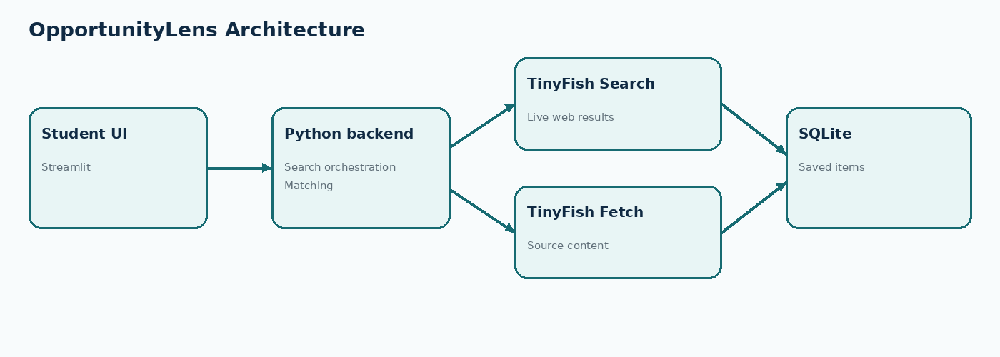

# OpportunityLens 🔎

**Find opportunities. Understand your fit. Follow the original source.**

OpportunityLens is a student-focused discovery tool for finding internships, hackathons, scholarships, fellowships and early-career opportunities from the live web. It uses TinyFish Search to discover pages and TinyFish Fetch to retrieve source content on demand. A transparent heuristic ranks relevance against a student profile, and users can save opportunities and track their application status locally.

> **Prototype note:** This MVP is a hackathon prototype. Match scores are relevance estimates, not verified eligibility decisions. Always confirm requirements and deadlines on the official source.

## Features

- Live web search through the TinyFish Search API.
- On-demand source retrieval through TinyFish Fetch.
- Profile inputs for degree, year, skills, interests and location.
- Explainable, rule-based relevance score.
- Original source links and fetchable source content.
- Local SQLite saved list and application status tracking.
- Friendly error handling for missing API keys, network errors and malformed API responses.

## Tech stack

- Python 3.11+
- Streamlit UI
- TinyFish Search and Fetch REST APIs
- SQLite for local persistence
- pytest for a small matching test

## Architecture



```text
Student
  |
  v
Streamlit UI (app.py)
  |
  +--> TinyFish Search API --> Live search results and source URLs
  |
  +--> TinyFish Fetch API --> Clean source content on demand
  |
  +--> Explainable matching utility --> Match score and reasons
  |
  +--> SQLite --> Saved opportunities and application status
```

## Setup

### 1. Requirements

Install Python 3.11 or newer. Create a TinyFish account and generate an API key at [TinyFish API keys](https://agent.tinyfish.ai/api-keys).

### 2. Download and install

```bash
git clone https://github.com/YOUR_USERNAME/opportunitylens.git
cd opportunitylens

python -m venv .venv
```

Activate the virtual environment:

**Windows PowerShell**
```powershell
.venv\Scripts\Activate.ps1
```

**macOS / Linux**
```bash
source .venv/bin/activate
```

Install dependencies:

```bash
pip install -r requirements.txt
```

### 3. Configure the API key

Copy `.env.example` to `.env`, then replace the placeholder with your actual key.

**Windows PowerShell**
```powershell
Copy-Item .env.example .env
```

**macOS / Linux**
```bash
cp .env.example .env
```

Open `.env` and set:

```text
TINYFISH_API_KEY=your_new_key_here
```

Generate a fresh key from the TinyFish API Keys page if a key was ever pasted into a chat, screenshot, or public issue. Never commit `.env` or paste an API key into source code, screenshots, PPTs, or public issues. `.gitignore` excludes it.

### 4. Run

```bash
streamlit run app.py
```

Streamlit will print a local URL, normally `http://localhost:8501`.

### 5. Run tests

```bash
pytest -q
```

## TinyFish integration

OpportunityLens calls the actual TinyFish REST APIs:

- **Search:** `GET https://api.search.tinyfish.ai?query=...`
- **Fetch:** `POST https://api.fetch.tinyfish.ai` with a JSON body containing `urls`, `format`, `links`, `image_links`, `iframe_links`, and `page_metadata`.

Both requests send the key in the `X-API-Key` header. Search results are normalized into title, domain/site name, snippet and URL. Fetch is initiated when the user clicks **Fetch source details** on a result. Fetch supports partial failures and the app surfaces a helpful message when a page cannot be read. The app does not embed an API key; configure it locally through `.env`.

Official references:
- [TinyFish Search API reference](https://docs.tinyfish.ai/search-api/reference)
- [TinyFish Fetch API reference](https://docs.tinyfish.ai/fetch-api/reference)
- [TinyFish authentication](https://docs.tinyfish.ai/authentication)

## How matching works

The current MVP uses explainable keyword overlap and lightweight signals from the result title/snippet. It does not use a trained ML model and does not certify eligibility. This is intentional for the first prototype: the score is easy to explain and does not invent missing requirements. A future version could add structured extraction from fetched content, stronger eligibility rules, duplicate detection and an optional LLM-based explanation.

## Data and privacy

- Saved items are stored in `opportunitylens.db` in the local project directory.
- No login, hosted backend, cloud sync or automatic application submission is implemented.
- Profile inputs are used in the current UI session and are not sent to TinyFish as separate personal profile data; the search query includes the user's search text and selected opportunity categories.
- The app fetches only the selected result URL after a user action.

## Known limitations

- Search quality depends on TinyFish results and the query.
- Results may be expired, incomplete, duplicated or not official.
- Match scores are heuristic relevance indicators, not official eligibility decisions.
- Deadlines are not automatically verified or normalized yet.
- Saved items are local to one computer/browser environment; there is no cross-device sync.
- An AI/LLM model is not required by the current implementation. The current "intelligence" is retrieval plus transparent rule-based matching.
- Test the API with your own key before recording a demo; live service behavior cannot be guaranteed by the repository alone.

## Demo walkthrough

1. Start the app and enter a profile.
2. Search for a specific opportunity type, for example "Python internships for second-year B.Tech students in India".
3. Show that results include live URLs returned by TinyFish Search.
4. Click **Fetch source details** on a result to demonstrate TinyFish Fetch.
5. Explain the heuristic score and why it is not a final eligibility decision.
6. Save a result and update its status in the Saved opportunities tab.

## Suggested next steps

- Extract deadlines, eligibility criteria and application URLs into structured fields.
- Add duplicate detection and freshness indicators.
- Add filters for remote/on-site, stipend and application deadline.
- Add optional AI-generated explanations grounded in fetched page text.
- Add notifications and user accounts only after the core flow is reliable.

## License

For hackathon use. Add an explicit open-source license if you want to permit reuse under defined terms.
